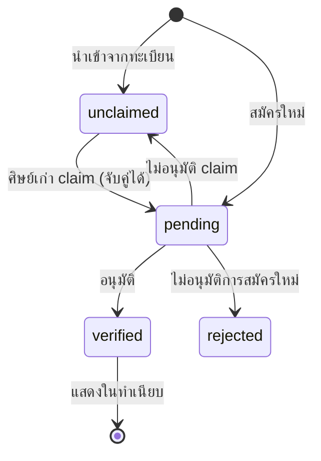

# 🛠️ Admin Back Office

ระบบจัดการสำหรับเจ้าหน้าที่ ตาม [[SRS]] §3.12 (FR-ADM-10 ถึง 21) · โค้ดอยู่ที่ `webapp/src/app/admin/`

## หน้าจอ

| URL | หน้าที่ | บทบาท |
|---|---|---|
| `/admin/login` | เข้าสู่ระบบ | — |
| `/admin` | ภาพรวม: จำนวนสมาชิก ข่าว และกิจกรรมล่าสุด | admin, editor (editor ไม่เห็นตัวเลขสมาชิก) |
| `/admin/members` | รายชื่อ + จำนวนแยกตามสถานะ ค้นหาและกรอง | **admin เท่านั้น** |
| `/admin/members/:id` | ข้อมูลรายบุคคล + อนุมัติ/ไม่อนุมัติ | **admin เท่านั้น** |
| `/admin/news` | รายการข่าวทั้งหมด รวมฉบับร่าง | admin, editor |
| `/admin/news/new`, `/:id` | เขียน/แก้ข่าว + ภาพปก + ตั้งเวลา | admin, editor |
| `/admin/content` | แก้ข้อความบนเว็บ + เปลี่ยนรูป | admin, editor |

## ทำไมแยก `admin` กับ `editor`

งานข่าวและแก้ข้อความเว็บมักมอบให้เจ้าหน้าที่ประชาสัมพันธ์หรือนักศึกษาช่วยงาน คนกลุ่มนี้ไม่จำเป็นต้องเห็นเบอร์โทร อีเมล และวันเกิดของศิษย์เก่า → ตามหลักเข้าถึงเท่าที่จำเป็นใน [[PDPA and Privacy]]

`editor` จะไม่เห็นเมนูสมาชิก ไม่เห็นตัวเลขสมาชิกบนหน้าภาพรวม และถ้าพิมพ์ URL ตรงจะถูกส่งกลับ — ทดสอบแล้ว

## การจัดการข้อมูลสมาชิก

**จำนวนที่แสดง (FR-ADM-18)**
- แยกตามสถานะ: ยืนยันแล้ว / รอตรวจสอบ / ยังไม่ Claim / ไม่อนุมัติ — คลิกที่ตัวเลขเพื่อกรองรายการ
- แยกตามระดับการศึกษา, ช่วงรุ่น (ทศวรรษ พ.ศ.), สาขา 10 อันดับแรก
- **สาขานับตามชื่อปัจจุบัน** — ผู้ที่เรียน "ช่างยนต์" ถูกนับรวมกับ "เทคนิคยานยนต์" ([[Program Taxonomy Research]])
- สัดส่วนโปรไฟล์ที่อัปเดตใน 12 เดือน (ตัวชี้วัดปัญหาข้อมูลตาย — [[Engagement Strategy]])

**การค้นหา (FR-ADM-19)** ค้นได้จาก ชื่อ · **ชื่อเดิม** · ชื่อเล่น · รหัสนักศึกษา · อีเมล

**การเปิดดูรายบุคคล (FR-ADM-20)** ทุกครั้งที่เปิดหน้าข้อมูลสมาชิก ระบบบันทึก `member.view` ลง audit log พร้อมผู้เปิดและเวลา

**การอนุมัติ (FR-ADM-21)**

การไม่อนุมัติ claim คืนระเบียนเป็น `unclaimed` เพราะเจ้าของตัวจริงอาจยังไม่ได้มา claim — ไม่ควรล็อกระเบียนไว้เพราะคนอื่นมาอ้าง

## แก้ข้อความและรูปบนเว็บ

แก้ได้เฉพาะ **ตำแหน่งที่กำหนดไว้** ไม่ใช่ตัวสร้างหน้าเว็บ เพื่อให้เว็บยังตรงกับ [[Visual Design]] เมื่อมีหลายคนแก้

| กลุ่ม | รายการ |
|---|---|
| หน้าแรก — Hero | ข้อความบรรทัดเล็ก, หัวข้อ 2 บรรทัด, คำอธิบาย |
| สารจากคณบดี | ข้อความ, ชื่อ/ตำแหน่ง, หน่วยงาน |
| ข้อมูลติดต่อ | หน่วยงาน, ที่อยู่, โทร, อีเมล, LINE OA — แสดงทั้งแถบบน, หน้าติดต่อ, ท้ายเว็บ |
| ลิงก์โซเชียล | Facebook, LINE, YouTube — `https://` เท่านั้น ว่างไว้ = ไม่แสดงไอคอน |
| ส่วนท้ายเว็บ | คำอธิบายเครือข่าย |
| **รูปภาพ** | ภาพหน้าแรก, ภาพคณบดี, ภาพปกข่าวเริ่มต้น — พร้อมคำอธิบายรูปและปุ่มคืนค่า |

ถ้าฐานข้อมูลล่ม เว็บสาธารณะจะแสดงข้อความเริ่มต้นที่ฝังในโค้ดแทน ไม่ขึ้นหน้า error

## ความปลอดภัย

| เรื่อง | วิธี |
|---|---|
| รหัสผ่าน | bcrypt cost 12 ผ่าน pgcrypto |
| Session | token สุ่ม 256 bit ใน cookie httpOnly · DB เก็บแค่ SHA-256 · หมดอายุ 8 ชม. |
| ด่านแรก | middleware ตรวจว่ามี cookie (edge runtime เชื่อม DB ไม่ได้) |
| ด่านจริง | `requireAdmin()` ตรวจ token/วันหมดอายุ/บัญชียังใช้งาน ทุกหน้าและทุก action — cookie ปลอมผ่านด่านแรกได้แต่ถูกตีกลับที่ด่านนี้ (ทดสอบแล้ว) |
| เดารหัส | ล็อกต่อ**อีเมล** 5 ครั้ง/15 นาที · ข้อความเดียวกันไม่ว่าอีเมลมีอยู่หรือไม่ |
| บัญชีแรก | สร้างจาก `ADMIN_BOOTSTRAP_*` ใน `.env` **เฉพาะเมื่อยังไม่มีบัญชีใด** |
| Audit | ทุก action สำคัญ · ลบ/แก้ไม่ได้ (trigger) |

### บทเรียนจากการทดสอบ: IP ภายใน Docker

ทุก request เข้าแอปจาก docker gateway (`192.168.0.1`) การล็อกตาม IP ในตอนแรกจึงทำให้**ใครก็ได้พิมพ์รหัสผิด 5 ครั้งแล้วล็อกเจ้าหน้าที่ทุกคน** แก้โดยเชื่อ `X-Forwarded-For` เฉพาะเมื่อตั้ง `TRUST_PROXY=true` (มี reverse proxy ที่ตั้งค่าถูก) และล็อกหลักนับตามอีเมล → [[SRS]] NFR-SEC-09

## ยังไม่ได้ทำ

- [ ] หน้าจัดการบัญชีเจ้าหน้าที่ (เพิ่ม/ปิดบัญชี/เปลี่ยนบทบาท/เปลี่ยนรหัส) — ตอนนี้ต้องทำผ่าน SQL
- [ ] ส่งออกรายชื่อสมาชิก (FR-DIR-11) พร้อมบันทึก log
- [ ] จัดการคำขอใช้สิทธิตาม PDPA (FR-ADM-08)
- [ ] แก้ไขหลักสูตรผ่านหน้าเว็บ (FR-ADM-05)
- [ ] ตรวจข่าวของศิษย์เก่า (FR-ANEWS-08)

[[SRS]] · [[Database Design]] · [[PDPA and Privacy]] · [[Visual Design]]
