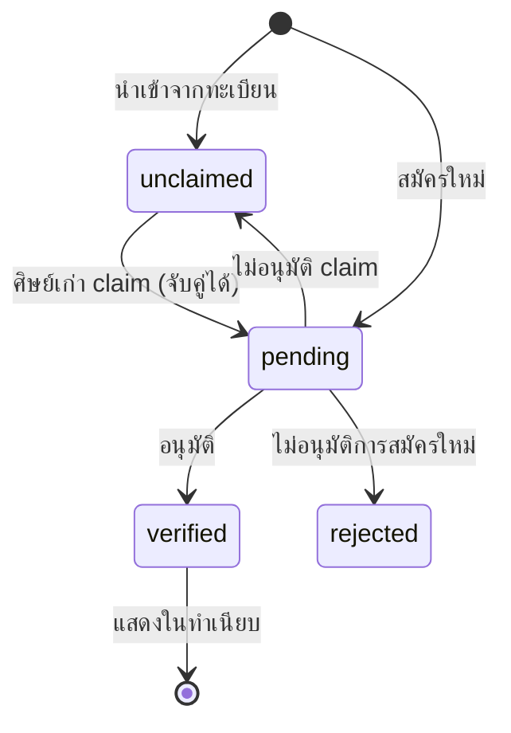

# 🛠️ Admin Back Office

ระบบจัดการสำหรับเจ้าหน้าที่ ตาม [[SRS]] §3.12 (FR-ADM-01 ถึง 21) และงานหลังบ้านของโมดูลอื่น · โค้ดอยู่ที่ `webapp/src/app/admin/`

## หน้าจอ

| URL | หน้าที่ | บทบาท |
|---|---|---|
| `/admin/login` | เข้าสู่ระบบ | — |
| `/admin` | ภาพรวม: จำนวนสมาชิก ข่าว และกิจกรรมล่าสุด | ทุกบทบาท (editor ไม่เห็นตัวเลขสมาชิก) |
| `/admin/members`, `/:id` | รายชื่อ จำนวน ค้นหา ส่งออก CSV · อนุมัติใบสมัคร | admin (อนุมัติ) · faculty (อ่านอย่างเดียว) |
| `/admin/moderation` | คิวตรวจข่าวศิษย์เก่า ประกาศงาน บทความ รายงานเนื้อหา · ปักหมุด ซ่อน | admin, editor |
| `/admin/news` | ข่าวทางการ + แท็ก + ไฟล์แนบ PDF + ตั้งเวลา | admin, editor |
| `/admin/events` | กิจกรรม ลงทะเบียน ส่งออกผู้เข้าร่วม ของที่ระลึก | admin, editor |
| `/admin/gallery` | อัลบั้มภาพกิจกรรม | admin, editor |
| `/admin/content` | แก้ข้อความบนเว็บ + เปลี่ยนรูป | admin, editor |
| `/admin/awards` | รอบเสนอชื่อ + ผลการพิจารณาของกรรมการ | admin, faculty |
| `/admin/surveys` | สร้างแบบสำรวจ เปิด/ปิด dashboard และ CSV สำหรับ QA | admin, faculty |
| `/admin/broadcast` | ส่งประกาศตามกลุ่ม · รอบยืนยันข้อมูล | admin |
| `/admin/pdpa` | คำขอใช้สิทธิของเจ้าของข้อมูล · ลบข้อมูลถาวร | admin |
| `/admin/import` | นำเข้า CSV จากทะเบียน | admin |
| `/admin/duplicates` | ระเบียนที่อาจซ้ำ + รวมระเบียน | admin |
| `/admin/reference` | หลักสูตร/สายการเปลี่ยนชื่อ ทักษะ กลุ่มอาชีพ | admin |
| `/admin/staff` | บัญชีเจ้าหน้าที่และบทบาท | admin |

## ทำไมแยก `admin` `editor` และ `faculty`

งานข่าวและแก้ข้อความเว็บมักมอบให้เจ้าหน้าที่ประชาสัมพันธ์หรือนักศึกษาช่วยงาน คนกลุ่มนี้ไม่จำเป็นต้องเห็นเบอร์โทร อีเมล และวันเกิดของศิษย์เก่า → ตามหลักเข้าถึงเท่าที่จำเป็นใน [[PDPA and Privacy]]

`editor` จะไม่เห็นเมนูสมาชิก ไม่เห็นตัวเลขสมาชิกบนหน้าภาพรวม และถ้าพิมพ์ URL ตรงจะถูกส่งกลับ — ทดสอบแล้ว

## การจัดการข้อมูลสมาชิก

**จำนวนที่แสดง (FR-ADM-18)**
- แยกตามสถานะ: ยืนยันแล้ว / รอตรวจสอบ / ยังไม่ Claim / ไม่อนุมัติ — คลิกที่ตัวเลขเพื่อกรองรายการ
- แยกตามระดับการศึกษา, ช่วงรุ่น (ทศวรรษ พ.ศ.), สาขา 10 อันดับแรก
- **สาขานับตามชื่อปัจจุบัน** — ผู้ที่เรียน "ช่างยนต์" ถูกนับรวมกับ "เทคนิคยานยนต์" ([[Program Taxonomy Research]])
- สัดส่วนโปรไฟล์ที่อัปเดตใน 12 เดือน (ตัวชี้วัดปัญหาข้อมูลตาย — [[Engagement Strategy]])

**การค้นหา (FR-ADM-19)** ค้นได้จาก ชื่อ · **ชื่อเดิม** · ชื่อเล่น · รหัสนักศึกษา · อีเมล

**การเปิดดูรายบุคคล (FR-ADM-20)** ทุกครั้งที่เปิดหน้าข้อมูลสมาชิก ระบบบันทึก `member.view` ลง audit log พร้อมผู้เปิดและเวลา

**การอนุมัติ (FR-ADM-21)**

การไม่อนุมัติ claim คืนระเบียนเป็น `unclaimed` เพราะเจ้าของตัวจริงอาจยังไม่ได้มา claim — ไม่ควรล็อกระเบียนไว้เพราะคนอื่นมาอ้าง

## แก้ข้อความและรูปบนเว็บ

แก้ได้เฉพาะ **ตำแหน่งที่กำหนดไว้** ไม่ใช่ตัวสร้างหน้าเว็บ เพื่อให้เว็บยังตรงกับ [[Visual Design]] เมื่อมีหลายคนแก้

| กลุ่ม | รายการ |
|---|---|
| หน้าแรก — Hero | ข้อความบรรทัดเล็ก, หัวข้อ 2 บรรทัด, คำอธิบาย |
| สารจากคณบดี | ข้อความ, ชื่อ/ตำแหน่ง, หน่วยงาน |
| ข้อมูลติดต่อ | หน่วยงาน, ที่อยู่, โทร, อีเมล, LINE OA — แสดงทั้งแถบบน, หน้าติดต่อ, ท้ายเว็บ |
| ลิงก์โซเชียล | Facebook, LINE, YouTube — `https://` เท่านั้น ว่างไว้ = ไม่แสดงไอคอน |
| ส่วนท้ายเว็บ | คำอธิบายเครือข่าย |
| **รูปภาพ** | ภาพหน้าแรก, ภาพคณบดี, ภาพปกข่าวเริ่มต้น — พร้อมคำอธิบายรูปและปุ่มคืนค่า |

ถ้าฐานข้อมูลล่ม เว็บสาธารณะจะแสดงข้อความเริ่มต้นที่ฝังในโค้ดแทน ไม่ขึ้นหน้า error

## ความปลอดภัย

| เรื่อง | วิธี |
|---|---|
| รหัสผ่าน | bcrypt cost 12 ผ่าน pgcrypto |
| Session | token สุ่ม 256 bit ใน cookie httpOnly · DB เก็บแค่ SHA-256 · หมดอายุ 8 ชม. |
| ด่านแรก | middleware ตรวจว่ามี cookie (edge runtime เชื่อม DB ไม่ได้) |
| ด่านจริง | `requireAdmin()` ตรวจ token/วันหมดอายุ/บัญชียังใช้งาน ทุกหน้าและทุก action — cookie ปลอมผ่านด่านแรกได้แต่ถูกตีกลับที่ด่านนี้ (ทดสอบแล้ว) |
| เดารหัส | ล็อกต่อ**อีเมล** 5 ครั้ง/15 นาที · ข้อความเดียวกันไม่ว่าอีเมลมีอยู่หรือไม่ |
| บัญชีแรก | สร้างจาก `ADMIN_BOOTSTRAP_*` ใน `.env` **เฉพาะเมื่อยังไม่มีบัญชีใด** |
| Audit | ทุก action สำคัญ · ลบ/แก้ไม่ได้ (trigger) |

### บทเรียนจากการทดสอบ: IP ภายใน Docker

ทุก request เข้าแอปจาก docker gateway (`192.168.0.1`) การล็อกตาม IP ในตอนแรกจึงทำให้**ใครก็ได้พิมพ์รหัสผิด 5 ครั้งแล้วล็อกเจ้าหน้าที่ทุกคน** แก้โดยเชื่อ `X-Forwarded-For` เฉพาะเมื่อตั้ง `TRUST_PROXY=true` (มี reverse proxy ที่ตั้งค่าถูก) และล็อกหลักนับตามอีเมล → [[SRS]] NFR-SEC-09

## บทบาท `faculty` (เพิ่ม 2026-10-30)

อาจารย์ฝ่ายประกันคุณภาพและกรรมการศิษย์เก่าดีเด่นต้องดูข้อมูลสมาชิกและรายงานแบบสำรวจ แต่ไม่ควรอนุมัติใบสมัครหรือแก้ข่าว จึงเป็นบทบาทแยก: อ่านรายชื่อสมาชิกและส่งออกได้ (ทุกครั้งบันทึก log) พิจารณารางวัล และจัดการแบบสำรวจ

## การตรวจสอบเนื้อหา

- ข่าวของศิษย์เก่าตรวจก่อนเผยแพร่เสมอ ยกเว้นผู้ที่ admin ให้สิทธิ์ “เผยแพร่ทันที” — **แต่ข่าวไว้อาลัยต้องตรวจทุกครั้ง** และผู้ตรวจต้องติ๊กยืนยันว่าตรวจข้อเท็จจริงแล้ว การอนุมัติไม่เปลี่ยนสถานะ `is_deceased` ของระเบียนโดยอัตโนมัติ
- ขอให้แก้ไข / ไม่อนุมัติ / ซ่อน / ลบ ต้องมีเหตุผล ผู้โพสต์เห็นเหตุผลนั้น และทุกการตัดสินใจลง audit log
- รายงานเนื้อหารวมเป็นรายการเดียวต่อชิ้นงาน ซ่อนแล้วรายงานทั้งหมดปิดพร้อมกัน

## ข้อมูลส่วนบุคคล

- **ลบข้อมูลถาวร** (คำขอประเภทลบ) ต้องติ๊กและพิมพ์ “ลบข้อมูล” · ระบบส่งอีเมลแจ้งก่อนลบ แล้วลบชื่อ ติดต่อ ประวัติงาน ทักษะ ข่าว บทความ ความคิดเห็น การลงทะเบียน ไฟล์ใน MinIO และปิดบัญชี — เหลือเฉพาะสาขาและปีเพื่อให้สถิติถูกต้อง
- **รวมระเบียน** ไม่ทำอัตโนมัติ: ผู้ดูแลเลือกระเบียนที่เก็บและยืนยัน ชื่อของระเบียนที่ถูกรวมกลายเป็นชื่อเดิม และเก็บสำเนา JSON ไว้ใน `alumni_merge`
- **นำเข้า** ไม่เขียนทับระเบียนที่มีรหัสนักศึกษาอยู่แล้ว เลขบัตร 4 หลักท้ายเก็บแบบ bcrypt

### บทเรียนจากการทดสอบ: input ชื่อ `id`

ฟอร์มที่มีปุ่มส่งหลายปุ่ม (อนุมัติ / ขอแก้ / ไม่อนุมัติ) เคยส่งค่าปุ่มไม่ถึง server: input ที่ชื่อ `id` ทำให้ `form.id` กลายเป็น element แทนข้อความ React จึงสร้าง input ชั่วคราวของปุ่มที่กดผิดฟอร์ม → ทุกฟอร์มใช้ชื่อ `recordId` แทน

## ยังไม่ได้ทำ

- [ ] เชื่อม API ระบบทะเบียน/CONGRATE โดยตรง (ตอนนี้นำเข้าจากไฟล์ CSV) — รอ ASM-01
- [ ] ทดสอบ LINE Login และการส่งทาง LINE กับ channel จริงของคณะ
- [ ] แยก role ฐานข้อมูลสำหรับ migration กับแอปก่อนขึ้นระบบจริง

[[SRS]] · [[Database Design]] · [[PDPA and Privacy]] · [[Visual Design]]
