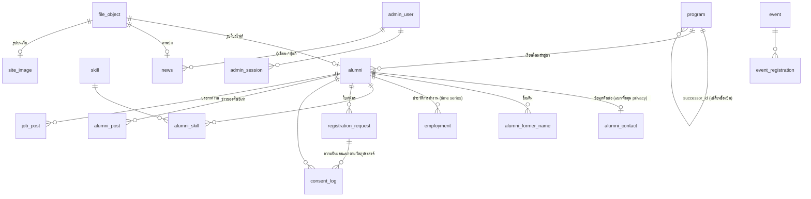

# 🗄️ Database Design

ออกแบบจริงที่ใช้งานใน `webapp/db/` (PostgreSQL 16) — ต่อยอดจาก [[Data Model]] ซึ่งเป็นร่างแนวคิด
ความต้องการอ้างอิง [[SRS]] v0.3

| ไฟล์ | เนื้อหา |
|---|---|
| `001_schema.sql` | ตารางหลัก, view, trigger |
| `002_seed_programs.sql` | หลักสูตร 32 รายการ พร้อมแหล่งที่มา → [[Program Taxonomy Research]] |
| `003_seed_sample.sql` | ศิษย์เก่าตัวอย่าง (บุคคลสมมติทั้งหมด) — ต้องลบก่อนใช้งานจริง |
| `004_admin.sql` | บัญชีเจ้าหน้าที่, session, ข้อความและรูปบนเว็บ → [[Admin Back Office]] |
| `005_remaining_srs.sql` | บัญชีศิษย์เก่า/นักศึกษา, rate limit, การมองเห็นรายฟิลด์, คำขอ PDPA, ปฏิสัมพันธ์ข่าว, กิจกรรม, งาน, บทความ, รางวัล, แบบสำรวจ, แจ้งเตือน, แกลเลอรี, นำเข้าและรวมระเบียน |
| `006_posts_events_jobs.sql` | รูปของข่าวศิษย์เก่า (`post_image`), จังหวัดของประกาศงาน, ฉบับร่างของกิจกรรม, index ค้นหาบทความ |

ไฟล์ทั้งหมดรันอัตโนมัติเมื่อ container ฐานข้อมูลเริ่มกับ volume ว่าง · `004`–`006` เขียนแบบ idempotent จึงรันซ้ำกับฐานข้อมูลเดิมได้

---

## ภาพรวมความสัมพันธ์



---

## 1. หลักสูตร — ปัญหาชื่อสาขาเปลี่ยน

ปัญหาจริงที่ค้นพบจากการสำรวจ: ชื่อสาขาเปลี่ยนบ่อย (ดู [[Program Taxonomy Research]]) ถ้าเก็บแค่ "สาขาปัจจุบัน" ศิษย์เก่าที่จบ **ปวส. ช่างยนต์** จะหาสาขาตัวเองไม่เจอ แต่ถ้าเก็บชื่อเก่าอย่างเดียว สถิติจะแตกเป็นหลายกลุ่ม

**วิธีแก้:** เก็บทุกชื่อที่เคยมี และเชื่อมกันด้วย `successor_id`

| คอลัมน์ | ความหมาย |
|---|---|
| `code` | key คงที่ เช่น `hvc-auto-legacy` |
| `degree_level` | ปวส. · อส.บ. · ทล.บ. · วศ.บ. · สถ.บ. · วศ.ม. |
| `study_plan` | 2ปี · 3ปี · 4ปี · เทียบโอน · ต่อเนื่อง |
| `status` | active · renamed · closed · planned |
| `successor_id` | หลักสูตรที่มาแทน |
| `source` / `source_note` | registrar · web_official · web_secondary · user_reported |
| `verified` | ยืนยันกับงานทะเบียนแล้วหรือยัง |

View **`program_resolved`** เดินตาม `successor_id` แบบ recursive จนถึงชื่อล่าสุด ให้ทั้ง `name_th` (ชื่อตอนเรียน) และ `current_name_th` (ชื่อปัจจุบัน):

```
ช่างยนต์                              → เทคนิคยานยนต์
เทคโนโลยีอุตสาหการ (อส.บ.)            → วิศวกรรมอุตสาหการ (ต่อเนื่อง)
วิศวกรรมคอมพิวเตอร์และระบบอัตโนมัติ    → วิศวกรรมคอมพิวเตอร์
```

ห้ามลบแถวใน `program` — `alumni.program_id` เป็น foreign key จึงลบไม่ได้อยู่แล้วเมื่อมีผู้อ้างถึง

---

## 2. ศิษย์เก่า

| ตาราง | เหตุผลที่แยก |
|---|---|
| `alumni` | ข้อมูลตัวตน + สถานะ claim (`unclaimed` / `pending` / `verified` / `rejected`) |
| `alumni_contact` | แยกออกเพื่อให้กฎ privacy (`visibility`) อยู่ที่เดียว |
| `alumni_former_name` | ชื่อเดิมหลายรายการ — ค้นหาด้วย trigram ได้ |
| `employment` | เก็บเป็นลำดับเวลา ไม่ใช่ "งานปัจจุบัน" ช่องเดียว เพื่อติดตามเส้นทางอาชีพระยะยาว |

**การยืนยันตัวตนตอน claim:** เก็บเฉพาะเลขบัตรประชาชน **4 หลักท้าย** และเก็บเป็น bcrypt hash (`id_last4_hash`) — ไม่มีทางกู้กลับเป็นเลข

**ค้นชื่อภาษาไทย:** ใช้ `pg_trgm` index บน `first_name_th || ' ' || last_name_th` ทั้งในตารางหลักและตารางชื่อเดิม ทนต่อการสะกดใกล้เคียง (ทดสอบแล้ว: ค้น "สุดารัต แสงทอง" เจอ "สุดารัตน์ ทองมี" จากชื่อเดิม)

**View `directory_public`:** คืนเฉพาะ `claim_status = 'verified'` และไม่เสียชีวิต — ทำเนียบสาธารณะต้องอ่านจาก view นี้เท่านั้น

---

## 3. การสมัครและความยินยอม

- `registration_request.payload` เก็บสิ่งที่ผู้สมัครส่งมา**ตามจริง** (jsonb) ให้ผู้ตรวจเห็นข้อมูลต้นฉบับแม้ภายหลังจะแก้แถว `alumni` — แต่**ตัดเลขบัตร/วันเกิดที่ใช้ยืนยันออก**ก่อนบันทึก
- `consent_log` แยกแถวต่อวัตถุประสงค์ (`data_processing` / `directory_listing` / `news`) พร้อมเวอร์ชันนโยบาย — การถอนความยินยอมคือการเพิ่มแถวใหม่ ไม่ใช่แก้แถวเดิม
- ทั้งหมดเขียนใน transaction เดียว ใบสมัครที่บันทึกครึ่ง ๆ กลาง ๆ จึงเกิดขึ้นไม่ได้

---

## 4. ไฟล์ (MinIO)

`file_object` เป็นทะเบียนของทุกไฟล์ใน bucket

| purpose | ใครดูได้ |
|---|---|
| `profile_photo`, `document` | เฉพาะเจ้าหน้าที่ที่เข้าสู่ระบบ |
| `news_image`, `site_image` | ทุกคน |

- bucket เป็น **private** — เบราว์เซอร์ได้ไฟล์ผ่าน `/api/files/:id` ซึ่งตรวจสิทธิ์ก่อน stream
- ชื่อ object สร้างจาก UUID (`profiles/2569/10/<uuid>.png`) ไม่ใช้ชื่อไฟล์ของผู้ใช้
- ตรวจชนิดไฟล์จาก magic bytes ก่อนบันทึก
- ไม่ใช้ presigned URL: client ภายใน docker sign ด้วย hostname ภายใน การเปลี่ยน host ภายหลังทำให้ลายเซ็น SigV4 ใช้ไม่ได้

---

## 5. หลังบ้าน (004_admin.sql)

| ตาราง | หน้าที่ |
|---|---|
| `admin_user` | บัญชีเจ้าหน้าที่ · bcrypt (cost 12) · role `admin` / `editor` |
| `admin_session` | เก็บ **SHA-256 ของ token** เท่านั้น |
| `site_setting` | ข้อความที่แก้ได้ — key ตายตัว + `kind` (text/textarea/email/phone/url) + `max_length` |
| `site_image` | ตำแหน่งรูป (hero, dean, news.default) → `file_id` หรือรูปเริ่มต้น |
| `news` (+คอลัมน์) | `is_pinned`, `author_id`, `updated_by`, `updated_at` · `published_at` NULL = ฉบับร่าง, อนาคต = ตั้งเวลา |

---

## 5b. โมดูลที่เพิ่มใน 005–006

| กลุ่ม | ตาราง | หมายเหตุ |
|---|---|---|
| บัญชี | `account`, `account_session`, `account_token`, `rate_event` | แยกจากบัญชีเจ้าหน้าที่ · เก็บ hash ของ token เท่านั้น · rate limit ตามบัญชี/อีเมล ไม่ใช่ IP |
| ความเป็นส่วนตัว | `alumni_contact.field_visibility`, view `alumni_latest_consent`, `directory_public`, `pdpa_request` | ทำเนียบแสดงเฉพาะ verified + ยินยอมล่าสุด + ไม่ถูก anonymize |
| ข่าวศิษย์เก่า | `alumni_post` (+draft, image, submitted_at), `alumni_post_tag`, `_reaction`, `_comment`, `content_report` | การมองเห็นของข่าวตัดสินใน SQL ที่เดียว (`postVisibleSql`) ใช้ทั้งฟีด โปรไฟล์ และการเสิร์ฟรูป |
| กิจกรรม | `event` (+is_published, closes_at), `event_registration` (+cancelled_at, reminded_at), `event_item`, `event_order` | จองที่นั่ง/ของล็อกแถวด้วย `FOR UPDATE` กันจองเกิน |
| งาน | `job_post` (+province, apply_url, contact_email), `job_post_program`, `job_post_skill` | หมดอายุด้วยเงื่อนไข `closes_at` ในคำสั่ง SQL |
| ความรู้ / รางวัล | `kb_article`, `award_round`, `award_nomination` | ได้รับรางวัล → `alumni.is_notable` คำนวณจากรางวัลที่เหลือ |
| แบบสำรวจ | `survey` (questions JSON), `survey_response` (program, graduation_year, years_since_grad), `employer_invite` | ตอบได้ครั้งเดียวต่อรอบ · ลิงก์นายจ้างใช้ครั้งเดียว 30 วัน · รายงานซ่อนกลุ่ม n<5 |
| แจ้งเตือน | `notification` (outbox + inbox), `notification_pref`, `broadcast`, `data_confirm_round`, `cron_run` | cron ส่งอีเมล/LINE · `dedupe_key` กันส่งซ้ำ |
| ข่าวทางการ | `news_tag`, `news_attachment`, `gallery_album`, `gallery_photo` | |
| หลังบ้าน | `import_batch`, `alumni_merge`, `job_category` | |

## 6. Audit log

`audit_log` เป็น **append-only** ด้วย trigger ที่ปฏิเสธ UPDATE / DELETE / TRUNCATE

> เดิมใช้ `REVOKE UPDATE, DELETE ... FROM PUBLIC` แต่ทดสอบแล้วพบว่า**ไม่มีผลกับเจ้าของตาราง** ซึ่งแอปใช้เชื่อมต่ออยู่ จึงเปลี่ยนเป็น trigger

เหตุการณ์ที่บันทึก: `registration.submit` · `admin.login` · `admin.login_failed` · `member.view/approve/reject/export/import/merge` · `directory.profile_view` · `news.*` · `content.*` · `post.*` · `job.*` · `kb.*` · `event.*` · `award.*` · `survey.*` · `broadcast.send` · `pdpa.handle/erase` · `staff.*` · `reference.*` · `profile.*`

---

## 7. ข้อจำกัดที่รู้แล้ว

- Enum label ของ PostgreSQL ยาวได้ไม่เกิน **63 bytes** — ภาษาไทยใช้ 3 bytes/ตัวอักษร จึงไม่เกิน 21 ตัว (เคยชนกับ "ข่าวประชาสัมพันธ์ทั่วไป" ต้องย่อ)
- แอปเชื่อมต่อเป็นเจ้าของ schema — ก่อนใช้งานจริงควรแยก role สำหรับ migration กับ role สำหรับแอป
- ยังไม่มีระบบ migration อัตโนมัติ สำหรับฐานข้อมูลที่มีอยู่แล้วให้รันไฟล์ใหม่ด้วยมือ:
  `docker exec -i ksu-alumni-db psql -U alumni -d alumni < db/006_posts_events_jobs.sql`

[[SRS]] · [[Data Model]] · [[Architecture]] · [[PDPA and Privacy]]
